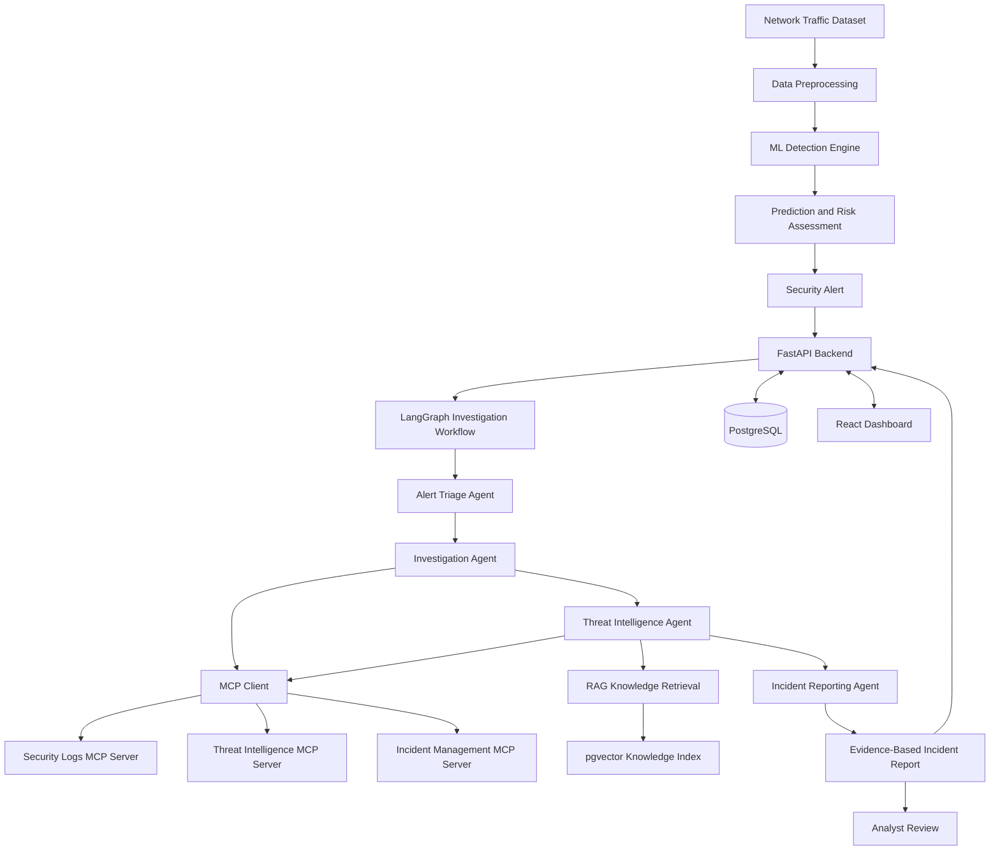
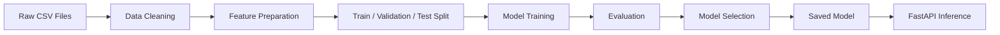
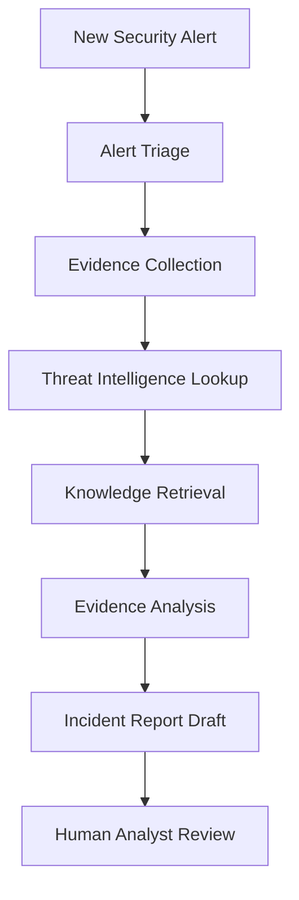
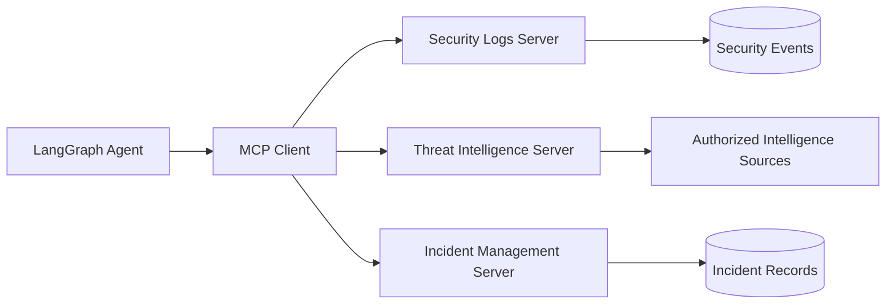

# 🛡️ CyberAgent AI
### Intelligent Cyberattack Detection & Autonomous Security Investigation

<p align="center">
  <strong>Machine Learning • Agentic AI • LangGraph • MCP • RAG • Cybersecurity</strong>
</p>

<p align="center">
  An AI-powered cybersecurity platform designed to detect suspicious network activity, automate security investigations, and generate evidence-based incident reports.
</p>

<p align="center">
  
  
  
  
  
</p>

<p align="center">
  
  
  
</p>

---

## 📑 Table of Contents

- [Overview](#-overview)
- [Problem Statement](#-problem-statement)
- [Project Objectives](#-project-objectives)
- [Key Features](#-key-features)
- [System Architecture](#-system-architecture)
- [How It Works](#-how-it-works)
- [Technology Stack](#-technology-stack)
- [Project Structure](#-project-structure)
- [Machine Learning Pipeline](#-machine-learning-pipeline)
- [Agentic AI Investigation](#-agentic-ai-investigation)
- [MCP Integration](#-mcp-integration)
- [Getting Started](#-getting-started)
- [Development Roadmap](#-development-roadmap)
- [Security Considerations](#-security-considerations)
- [Future Enhancements](#-future-enhancements)
- [Project Status](#-project-status)

---

## 🌟 Overview

**CyberAgent AI** is an intelligent cybersecurity platform that combines machine learning, large language models, autonomous AI agents, and security tools to support cyberattack detection and incident investigation.

Traditional Intrusion Detection Systems (IDS) mainly focus on identifying suspicious network behavior and generating alerts.

However, security analysts must often investigate these alerts manually, analyze logs, identify possible attack techniques, and prepare incident reports.

CyberAgent AI aims to improve this process by developing an intelligent system that can:

- Detect suspicious network activity using machine learning.
- Classify traffic as benign or potentially malicious.
- Generate structured security alerts.
- Investigate alerts through AI-powered workflows.
- Access cybersecurity tools using Model Context Protocol (MCP).
- Retrieve relevant cybersecurity knowledge using RAG.
- Generate evidence-based security investigation reports.
- Present findings through an interactive security dashboard.

> **Project Vision:** Move beyond traditional intrusion detection by developing an intelligent cybersecurity assistant that detects potential threats, investigates suspicious activities, and supports human security analysts in making informed decisions.

**Development note:** This repository is under active development. The capabilities described below represent the target architecture unless explicitly marked as implemented.

---

## 🚨 Problem Statement

Modern networks generate large volumes of security events, making it difficult for security teams to identify and investigate suspicious activities efficiently.

Traditional security monitoring approaches face several challenges:

| Challenge | Description |
|---|---|
| Alert Overload | Security systems can produce large numbers of alerts requiring investigation. |
| Manual Investigation | Analysts must examine logs and gather evidence manually. |
| False Positives | Benign activities may be incorrectly classified as malicious. |
| Tool Fragmentation | Relevant security information may be distributed across multiple tools. |
| Investigation Time | Collecting evidence and preparing incident reports can take considerable time. |
| Limited Explainability | Detection results may not clearly communicate why an event is suspicious. |

### Proposed Solution

CyberAgent AI combines machine learning-based detection with structured agentic investigation workflows.

Instead of stopping after detecting a suspicious event, the system is designed to collect relevant evidence, consult security knowledge, and prepare an investigation report for analyst review.

---

## 🎯 Project Objectives

The primary objectives are:

1. Build a machine learning pipeline for network intrusion detection.
2. Compare multiple machine learning classification models.
3. Develop a REST API for security predictions and alert management.
4. Create structured AI investigation workflows using LangGraph.
5. Integrate security tools using Model Context Protocol.
6. Implement Retrieval-Augmented Generation for security knowledge.
7. Store security alerts, investigation records, and relevant evidence.
8. Develop an interactive security monitoring dashboard.
9. Generate explainable security investigation reports.
10. Support human oversight of security response decisions.

---

## ✨ Key Features

### 🔍 1. Machine Learning-Based Threat Detection

The planned detection engine uses supervised machine learning to analyze network-flow features and identify potentially malicious activities.

**Capabilities:**

- Network traffic preprocessing
- Feature validation and transformation
- Binary classification: Benign vs Attack
- Multiple model training and comparison
- Classification evaluation
- Risk score generation
- Security alert creation

**Planned models:**

- Logistic Regression
- Random Forest
- XGBoost

Model selection will consider detection performance, false-positive rates, inference latency, and generalization.

### 🧠 2. Agentic AI Security Investigation

CyberAgent AI plans to use LangGraph to coordinate AI-powered investigation workflows.

The investigation process will involve specialized components responsible for gathering evidence, investigating suspicious events, retrieving threat intelligence, and generating reports.

**Planned agents:**

| Agent | Responsibility |
|---|---|
| Alert Triage Agent | Analyze incoming alerts and determine investigation priority. |
| Investigation Agent | Retrieve security logs and examine suspicious activity. |
| Threat Intelligence Agent | Gather available threat intelligence and attack technique information. |
| Reporting Agent | Generate structured incident investigation reports. |

### 🔌 3. Model Context Protocol Integration

Model Context Protocol (MCP) provides a standardized interface for connecting AI applications to external tools and data sources.

CyberAgent AI plans to use MCP servers to expose security investigation tools to AI agents.

Potential tools include:

| MCP Tool | Description |
|---|---|
| `search_security_logs` | Search security events based on investigation criteria. |
| `get_ip_history` | Retrieve historical observations associated with an IP address. |
| `get_alert_details` | Retrieve security alert information. |
| `lookup_attack_technique` | Access relevant cybersecurity technique information. |
| `get_threat_intelligence` | Retrieve available intelligence about suspicious indicators. |
| `create_incident_draft` | Prepare an incident report for analyst review. |

### 📚 4. Retrieval-Augmented Generation

The planned RAG system will retrieve cybersecurity knowledge relevant to an active investigation.

Potential knowledge sources include:

- MITRE ATT&CK documentation
- Cybersecurity incident response guidance
- Attack technique descriptions
- Security research documents
- Internal authorized security documentation

Retrieved information will provide additional context for investigation explanations.

RAG knowledge is supporting context and is not automatically considered evidence that a particular attack occurred.

### 📊 5. Security Operations Dashboard

A React-based dashboard is planned to provide a centralized interface for security monitoring.

**Planned dashboard modules:**

- Overview of security alerts
- Network traffic analysis
- Threat statistics
- AI investigation results
- Incident report management
- Investigation history
- Analyst review and approval

---

## 🏗️ System Architecture

CyberAgent AI uses a modular architecture combining machine learning detection, backend services, AI investigation workflows, external security tools, and persistent storage.



### Architecture Components

| Component | Technology | Responsibility |
|---|---|---|
| Data Processing | Pandas, NumPy | Data cleaning and feature preparation |
| Detection Engine | Scikit-learn, XGBoost | Classify network activity |
| Backend API | FastAPI | Provide prediction and application APIs |
| AI Orchestration | LangGraph | Coordinate investigation workflows |
| Security Tools | MCP Python SDK | Standardized access to external tools |
| Knowledge Retrieval | LangChain, Embeddings | Retrieve relevant cybersecurity documents |
| Vector Search | PostgreSQL + pgvector | Store and retrieve knowledge embeddings |
| Database | PostgreSQL | Store alerts and investigation records |
| Frontend | React, Tailwind CSS | Provide analyst dashboard |
| Deployment | Docker | Package application services |

All technologies in this table represent the planned stack.

---

## 🔄 How It Works

The target workflow consists of nine major stages.

### Step 1 — Network Traffic Collection

Network-flow data is obtained from an authorized dataset or supported monitoring source.

### Step 2 — Data Preprocessing

The system cleans and transforms the data into the feature format required by the detection model.

Typical operations include:

- Handling missing values
- Removing invalid records
- Encoding labels
- Selecting relevant features
- Applying appropriate feature transformations

### Step 3 — Machine Learning Detection

The trained classification model predicts whether the network-flow record represents benign or potentially malicious activity.

Example conceptual prediction:

```json
{
  "prediction": "Attack",
  "attack_probability": 0.94,
  "model": "XGBoost"
}
```

This example illustrates a possible future response format and is not a measured project result.

### Step 4 — Alert Generation

Potentially suspicious predictions are converted into structured alerts.

Alerts may include:

- Alert identifier
- Detection timestamp
- Classification result
- Model score
- Relevant network metadata
- Reference to original evidence

### Step 5 — Investigation Orchestration

LangGraph coordinates the investigation workflow and maintains investigation state.

### Step 6 — Security Tool Execution

Agents use authorized MCP tools to retrieve security events and additional investigation information.

### Step 7 — Evidence Analysis

An LLM evaluates the collected information and develops possible explanations.

The system should distinguish factual observations, external intelligence, and AI-generated hypotheses.

### Step 8 — Incident Reporting

The reporting agent prepares a structured investigation summary.

A report may contain:

- Incident overview
- Relevant network activity
- Collected evidence
- Possible attack techniques
- Confidence and uncertainty
- Recommended next steps

### Step 9 — Human Analyst Review

Security analysts review the generated findings.

Potentially disruptive remediation actions require explicit authorization.

---

## 🛠️ Technology Stack

### Machine Learning

- Python 3.11
- Scikit-learn
- XGBoost
- Pandas
- NumPy

### Backend Development

- FastAPI
- Pydantic
- PostgreSQL

### Agentic AI

- LangGraph
- Large Language Models
- MCP Python SDK

### Retrieval-Augmented Generation

- LangChain
- Sentence Transformers
- PostgreSQL with pgvector

### Frontend Development

- React
- Tailwind CSS

### Development and Deployment

- Git and GitHub
- Visual Studio Code
- Docker and Docker Compose
- Pytest

---

## 📂 Project Structure

The following structure represents the planned modular organization of CyberAgent AI.

```text
CyberAgent-AI/
│
├── backend/
│   ├── app/
│   │   ├── api/                  # FastAPI endpoints
│   │   ├── ml/                   # ML inference services
│   │   ├── agents/               # LangGraph workflows
│   │   ├── mcp_client/           # MCP client integration
│   │   ├── rag/                  # Knowledge retrieval
│   │   ├── database/             # Database integration
│   │   └── main.py               # Backend entry point
│   │
│   ├── mcp_servers/              # MCP tool servers
│   └── tests/                    # Backend tests
│
├── ml_training/
│   ├── scripts/                  # Model training scripts
│   └── notebooks/                # Experiments
│
├── data/
│   ├── raw/                      # Original datasets
│   └── processed/                # Processed datasets
│
├── models/                       # Saved ML models
├── frontend/                     # React application
├── docs/                         # Technical documentation
├── reports/                      # Evaluation reports
│
├── requirements.txt
├── .env.example
├── .gitignore
└── README.md
```

Some directories will be implemented in later phases.

Large datasets, trained model artifacts, sensitive records, and credentials should not be committed directly to Git.

---

## 🤖 Machine Learning Pipeline

### Dataset — CSE-CIC-IDS2018

CyberAgent AI plans to use the **CSE-CIC-IDS2018** dataset for the initial intrusion detection experiments.

The dataset contains labeled network traffic associated with benign and malicious network activity.

**Official dataset:**

https://www.unb.ca/cic/datasets/ids-2018.html

### Detection Objective

The initial machine learning task is binary classification.

| Class | Description |
|---|---|
| Benign | Network traffic labeled as normal |
| Attack | Network traffic labeled as malicious |

Multiclass attack classification may be considered in future phases.

### Training Pipeline



Data preparation that learns statistical parameters must be fitted only on training data to prevent data leakage.

### Model Comparison

Three model types are planned.

**Logistic Regression**

Provides a useful baseline for understanding classification performance.

**Random Forest**

Combines multiple decision trees to capture nonlinear relationships.

**XGBoost**

Uses gradient-boosted decision trees and is a strong candidate for structured network-flow data.

### Model Evaluation

Evaluation will use the following metrics:

| Metric | Purpose |
|---|---|
| Accuracy | Overall classification correctness |
| Precision | Proportion of predicted attacks that are actual attacks |
| Recall | Proportion of actual attacks successfully detected |
| F1-Score | Balance between precision and recall |
| Confusion Matrix | Breakdown of correct and incorrect predictions |
| ROC-AUC | Class separation across classification thresholds |
| PR-AUC | Precision-recall performance across thresholds |
| False-Positive Rate | Proportion of benign events incorrectly flagged |
| Inference Latency | Time required to generate predictions |

Special attention will be given to class imbalance, data leakage, and evaluation on held-out traffic.

**Model results:** Not yet published. Performance values will be added after training and evaluation.

---

## 🧠 Agentic AI Investigation

CyberAgent AI will use LangGraph to develop stateful investigation workflows.

Instead of relying on a single prompt, the system will coordinate a sequence of specialized investigation steps.

### Investigation Workflow



### Why LangGraph?

LangGraph supports structured workflows involving:

- Shared investigation state
- Conditional execution
- Tool calling
- Controlled agent coordination
- Human-in-the-loop workflows
- Multi-step investigation processes

The goal is to build a traceable investigation system where relevant actions, evidence, and decisions can be inspected.

---

## 🔌 MCP Integration

Model Context Protocol helps connect AI applications to tools through a standardized communication interface.

CyberAgent AI plans to implement custom MCP servers for security investigation functionality.

### MCP Architecture



### Planned MCP Server Responsibilities

**Security Logs MCP Server**

Provides controlled access to relevant log records and event history.

**Threat Intelligence MCP Server**

Retrieves available information about suspicious indicators and attack techniques.

**Incident Management MCP Server**

Supports retrieval of incidents and preparation of investigation drafts.

MCP standardizes tool access; it does not replace the database, machine learning model, or LangGraph orchestration engine.

---

## 🚀 Getting Started

### Prerequisites

Install the following development tools:

- Python 3.11
- Git
- Visual Studio Code
- pip
- A terminal application

The initial setup targets macOS but can be adapted to other supported operating systems.

### 1. Clone the Repository

Once the repository has been published, clone it using its actual GitHub URL:

```bash
git clone <YOUR_REPOSITORY_URL>
cd CyberAgent-AI
```

If you are already working in the project folder, skip this step.

### 2. Create a Python Virtual Environment

```bash
python3.11 -m venv .venv
```

### 3. Activate the Environment

For macOS and Linux:

```bash
source .venv/bin/activate
```

For Windows PowerShell:

```powershell
.\.venv\Scripts\Activate.ps1
```

### 4. Install Dependencies

If the project includes a populated `requirements.txt`, run:

```bash
python -m pip install -r requirements.txt
```

### 5. Run the Initial Backend Setup Check

For the initial project setup:

```bash
python -m backend.app.main
```

The setup-check output described in the original development plan is:

```text
CyberAgent AI backend is ready!
Project structure configured successfully.
```

This command is a project initialization check, not a FastAPI web server.

API endpoints, model inference, MCP services, and the frontend will be documented with their verified launch commands once implemented.

---

## 🧪 Testing Strategy

The planned testing strategy includes:

### Machine Learning Tests

- Dataset schema validation
- Missing-value handling
- Feature transformation consistency
- Model loading and inference
- Classification evaluation

### Backend Tests

- API request validation
- Response schema validation
- Error handling
- Database integration

### Agent and MCP Tests

- MCP tool input validation
- Tool execution error handling
- Investigation state management
- Agent workflow transitions
- Evidence reference validation
- Human approval boundaries

### Integration Tests

End-to-end tests will validate the flow from network data ingestion to prediction, alert creation, investigation, and report generation.

---

## 🗺️ Development Roadmap

| Phase | Development Milestone | Status |
|---|---|---|
| 01 | Development environment setup | ✅ Completed |
| 02 | Project structure and Git configuration | ✅ Completed |
| 03 | CSE-CIC-IDS2018 dataset exploration | 🔄 In Progress |
| 04 | Machine learning model training | ⏳ Planned |
| 05 | FastAPI prediction service | ⏳ Planned |
| 06 | PostgreSQL and alert management | ⏳ Planned |
| 07 | Custom MCP server implementation | ⏳ Planned |
| 08 | LangGraph investigation workflows | ⏳ Planned |
| 09 | RAG and threat intelligence integration | ⏳ Planned |
| 10 | React security dashboard | ⏳ Planned |
| 11 | Testing, security, and deployment | ⏳ Planned |

Roadmap statuses should be updated as each development phase is completed and verified.

---

## 🔐 Security Considerations

CyberAgent AI is developed for defensive security research, education, and authorized security analysis.

The system aims to follow secure engineering practices.

### Security Principles

- Analyze only authorized or publicly available security data.
- Protect secrets and API keys using environment variables.
- Avoid committing sensitive logs or credentials to GitHub.
- Validate user input and tool parameters.
- Enforce appropriate access controls.
- Treat logs and retrieved documents as untrusted content.
- Preserve references to original evidence.
- Separate confirmed observations from model-generated conclusions.
- Require human authorization for potentially disruptive response actions.
- Maintain investigation traceability.

AI-generated reports are decision-support artifacts and should not automatically be treated as verified incident findings.

---

## 🔮 Future Enhancements

Potential future improvements include:

- Multiclass attack classification
- Real-time network event ingestion
- Advanced anomaly detection
- Additional threat intelligence providers
- Model drift monitoring
- Explainable AI techniques
- Security alert prioritization
- Automated investigation summaries
- SIEM platform integration
- Human feedback for model improvement
- Advanced multi-agent collaboration
- Production monitoring and observability

---

## 🎓 Learning Objectives

CyberAgent AI is designed to demonstrate practical experience across multiple engineering areas.

| Area | Skills |
|---|---|
| Machine Learning | Data preprocessing, classification, feature engineering, and model evaluation |
| Agentic AI | Stateful workflows, LLM tool use, and agent orchestration |
| MCP | Tool servers, clients, and external system integration |
| RAG | Embeddings, document retrieval, and knowledge-grounded generation |
| Cybersecurity | Intrusion detection, security alerts, and incident investigation |
| Backend Engineering | REST APIs, data validation, and database integration |
| Frontend Engineering | Interactive dashboards and data visualization |
| DevOps | Docker, environment configuration, testing, and deployment |

---

## 📌 Project Status

**CyberAgent AI is an active development project.**

The initial development environment and project structure have been established.

Current development is focused on the CSE-CIC-IDS2018 dataset exploration stage.

The machine learning detection engine, agentic investigation workflows, MCP tool servers, RAG integration, and frontend dashboard remain planned development components.

Documentation and results will be updated as the project progresses.

---

## 👨‍💻 Author

**Arrathikasarma Aravinthan**

AI/ML Engineering Enthusiast | Python Developer | Agentic AI & Cybersecurity

**GitHub:** [github.com/arrathikan](https://github.com/arrathikan)

**LinkedIn:** [Aravinthan Arrathikasarma](https://www.linkedin.com/in/aravinthan-arrathikasarma/)

---

## ⭐ Support the Project

If you find CyberAgent AI interesting, consider starring the repository.

Your support encourages continued development and improvement.

---

<p align="center">
  <strong>🛡️ CyberAgent AI</strong>
</p>

<p align="center">
  <em>Detect Intelligently. Investigate Systematically. Respond Responsibly.</em>
</p>
