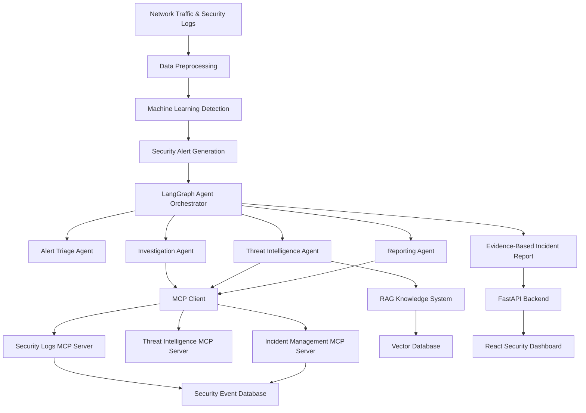

# 🛡️ CyberAgent AI
### Intelligent Cyberattack Detection & Autonomous Security Investigation

<p align="center">
  <strong>Machine Learning • Agentic AI • Model Context Protocol • Cybersecurity</strong>
</p>

<p align="center">
  An intelligent cybersecurity platform designed to detect suspicious network activity, investigate security alerts using autonomous AI agents, and generate evidence-based incident reports.
</p>

<p align="center">
  
  
  
  
  
</p>

<p align="center">
  
  
  
</p>

---

## 🌟 Overview

**CyberAgent AI** is an AI-powered cybersecurity platform that aims to transform traditional cyberattack detection into an intelligent, automated investigation process.

Traditional intrusion detection systems can identify suspicious activity and generate alerts. However, security analysts often need to manually examine logs, investigate indicators, and determine the significance of each alert.

CyberAgent AI is designed to support this process by combining **machine learning-based threat detection** with **AI-driven security investigations**.

The platform will use machine learning models to analyze network traffic, LangGraph-based agents to coordinate investigations, MCP servers to access security tools, and Retrieval-Augmented Generation (RAG) to provide relevant cybersecurity knowledge.

### Our Vision

> Moving beyond simply detecting cyberattacks toward building an intelligent AI system that investigates threats, explains its findings, and assists cybersecurity analysts in making informed decisions.

---

## 🎯 Project Objectives

The main objectives of CyberAgent AI are to:

- Detect suspicious network traffic using supervised machine learning.
- Classify network activity as benign or potentially malicious.
- Generate structured security alerts based on detection results.
- Investigate suspicious activity using Agentic AI.
- Retrieve security logs and threat intelligence through MCP tools.
- Use RAG to retrieve relevant cybersecurity knowledge.
- Generate explainable, evidence-based security incident reports.
- Provide an interactive security monitoring dashboard.
- Support human-approved security response workflows.

---

## ⚡ Key Features

### 🔍 1. Machine Learning-Based Threat Detection

Train and evaluate models such as **Random Forest and XGBoost** to identify suspicious patterns in network traffic.

**Planned capabilities:**
- Network-flow preprocessing and feature engineering.
- Binary classification: Benign vs Attack.
- Model comparison and evaluation.
- Prediction confidence or risk scores, with appropriate calibration.
- Security alert generation.

### 🧠 2. Agentic AI Security Investigation

Use **LangGraph** to coordinate intelligent investigation workflows.

The agents will collect evidence, investigate suspicious events, retrieve security knowledge, and prepare incident reports.

**Planned agents:**
- Alert Triage Agent
- Security Investigation Agent
- Threat Intelligence Agent
- Incident Reporting Agent

### 🔌 3. Model Context Protocol Integration

CyberAgent AI will use **MCP** to provide standardized communication between AI agents and external security tools.

**Planned MCP tools:**

| Tool | Purpose |
|---|---|
| `search_security_logs` | Search relevant security events |
| `get_ip_history` | Retrieve historical observations of an IP address |
| `get_alert_details` | Retrieve detection and alert information |
| `lookup_attack_technique` | Retrieve cybersecurity technique information |
| `get_threat_intelligence` | Retrieve available threat intelligence |
| `create_incident_draft` | Prepare an incident report for review |

### 📚 4. Retrieval-Augmented Generation

Integrate a cybersecurity knowledge base containing relevant security documentation, incident-response guidance, and MITRE ATT&CK information.

The RAG pipeline will retrieve useful references to support evidence-based investigation explanations.

### 📊 5. Security Operations Dashboard

A planned React dashboard will provide:

- Network traffic monitoring
- Security alert visualization
- Threat trends and statistics
- AI-generated investigation findings
- Incident reports
- Investigation history
- Analyst review and approval

---

## 🏗️ System Architecture

The following diagram illustrates the proposed CyberAgent AI architecture.



**Architecture responsibilities:**

- **Machine Learning:** Detect suspicious network activity.
- **LangGraph:** Coordinate investigation workflows.
- **MCP:** Standardize access to external tools and data.
- **RAG:** Retrieve relevant cybersecurity knowledge.
- **LLM:** Analyze evidence and generate explanations.
- **FastAPI:** Expose application APIs.
- **React:** Visualize alerts and investigation results.

---

## 🔄 How CyberAgent AI Works

The proposed investigation workflow follows these steps:

**Step 1 — Data Collection**

Collect network-flow records and authorized security logs.

**Step 2 — Data Preprocessing**

Clean data, validate features, and transform records into the format expected by the trained model.

**Step 3 — Attack Detection**

Use a machine learning classifier to determine whether the network activity is benign or potentially malicious.

**Step 4 — Alert Generation**

Generate a security alert containing the detection result and references to the original evidence.

**Step 5 — Agentic Investigation**

A LangGraph workflow coordinates the investigation and determines which information is required.

**Step 6 — MCP Tool Execution**

The AI agent accesses authorized security logs, threat intelligence, and incident records using MCP tools.

**Step 7 — Evidence Analysis**

The LLM analyzes retrieved evidence, identifies possible explanations, and distinguishes confirmed observations from hypotheses.

**Step 8 — Incident Reporting**

Generate a structured report containing supporting evidence, potential risks, and recommended next steps.

**Step 9 — Analyst Review**

A human analyst reviews the incident and approves any potentially disruptive response actions.

---

## 🧰 Technology Stack

| Category | Planned Technologies |
|---|---|
| Programming | Python 3.11 |
| Machine Learning | Scikit-learn, XGBoost |
| Data Processing | Pandas, NumPy |
| Backend | FastAPI, Pydantic |
| Agentic AI | LangGraph |
| MCP | Official MCP Python SDK |
| LLM Integration | OpenAI or another supported provider |
| RAG | LangChain, Sentence Transformers |
| Vector Database | PostgreSQL with pgvector |
| Database | PostgreSQL |
| Frontend | React, Tailwind CSS |
| Deployment | Docker, Docker Compose |
| Testing | Pytest |
| Version Control | Git, GitHub |

---

## 📂 Project Structure

```text
CyberAgent-AI/
│
├── backend/
│   ├── app/
│   │   ├── api/               # FastAPI routes
│   │   ├── ml/                # ML inference services
│   │   ├── agents/            # LangGraph workflows
│   │   ├── mcp_client/        # MCP client integration
│   │   ├── rag/               # Knowledge retrieval
│   │   ├── database/          # Database integration
│   │   └── main.py            # Backend entry point
│   │
│   ├── mcp_servers/           # MCP tool servers
│   └── tests/                 # Backend tests
│
├── ml_training/
│   ├── scripts/               # Training scripts
│   └── notebooks/             # Experiments
│
├── data/
│   ├── raw/                   # Original datasets
│   └── processed/             # Processed data
│
├── models/                    # Trained models
├── frontend/                  # React application
├── docs/                      # Documentation
├── reports/                   # Evaluation and reports
│
├── requirements.txt
├── .env.example
├── .gitignore
└── README.md
```

---

## 📊 Machine Learning Approach

### Dataset

The initial dataset planned for this project is **CSE-CIC-IDS2018**, which contains labeled network traffic from different benign and malicious activity scenarios.

Dataset: https://www.unb.ca/cic/datasets/ids-2018.html

### Models

We plan to compare:

1. Logistic Regression — baseline.
2. Random Forest — ensemble classifier.
3. XGBoost — gradient-boosted decision trees.

### Evaluation

Model performance will be evaluated using:

- Accuracy
- Precision
- Recall
- F1-Score
- Confusion Matrix
- ROC-AUC and PR-AUC
- False-positive rate
- Inference latency

Evaluation will use appropriate held-out data, with attention to class imbalance and data leakage.

**Model results will be published after training and evaluation.**

---

## 🚀 Getting Started

### Prerequisites

- Python 3.11
- Git
- Visual Studio Code
- macOS, Linux, or Windows with a compatible Python environment

### 1. Clone the repository

Once the repository is published:

```bash
git clone <YOUR_REPOSITORY_URL>
cd CyberAgent-AI
```

If you are already working in the local project folder, you can skip this step.

### 2. Create a virtual environment

```bash
python3.11 -m venv .venv
```

Activate on macOS/Linux:

```bash
source .venv/bin/activate
```

Activate on Windows PowerShell:

```powershell
.\.venv\Scripts\Activate.ps1
```

### 3. Install dependencies

As the project develops, its dependencies will be added to `requirements.txt`.

```bash
python -m pip install -r requirements.txt
```

### 4. Run the current setup test

At the current project setup stage:

```bash
python -m backend.app.main
```

Expected output:

```text
CyberAgent AI backend is ready!
Project structure configured successfully.
```

> The FastAPI server, ML prediction pipeline, MCP servers, and frontend will become available in later development phases.

---

## 🗺️ Development Roadmap

| Phase | Description | Status |
|---|---|---|
| 1 | Development environment setup | ✅ Completed |
| 2 | Project structure and Git configuration | 🚧 In progress |
| 3 | Dataset collection and exploration | ⏳ Planned |
| 4 | Machine learning model training | ⏳ Planned |
| 5 | FastAPI prediction service | ⏳ Planned |
| 6 | PostgreSQL and alert management | ⏳ Planned |
| 7 | MCP server implementation | ⏳ Planned |
| 8 | LangGraph investigation workflows | ⏳ Planned |
| 9 | Threat intelligence and RAG integration | ⏳ Planned |
| 10 | React dashboard | ⏳ Planned |
| 11 | Testing, security, and deployment | ⏳ Planned |

---

## 🔐 Security and Responsible Use

CyberAgent AI is intended for defensive cybersecurity research, learning, and authorized security monitoring.

The project follows these principles:

- Analyze only authorized or publicly available security datasets.
- Protect API keys and credentials.
- Validate data supplied to tools and AI agents.
- Enforce access controls for security records.
- Treat retrieved content and logs as untrusted inputs.
- Preserve evidence and source references.
- Require human approval before potentially disruptive security actions.
- Avoid treating LLM-generated hypotheses as verified facts.

---

## 🔮 Future Enhancements

Potential future improvements include:

- Multiclass attack classification
- Streaming security event ingestion
- Advanced anomaly detection
- Additional threat-intelligence integrations
- Model drift monitoring
- Human-feedback-based alert prioritization
- Security incident trend analytics
- Integration with authorized SIEM platforms
- More advanced multi-agent investigation workflows

---

## 📖 Learning Outcomes

Through CyberAgent AI, this project aims to demonstrate practical knowledge of:

**Machine Learning:** data preprocessing, feature engineering, model training, evaluation, and deployment.

**Agentic AI:** LLM reasoning, tool use, stateful workflows, and multi-agent coordination.

**MCP:** implementing standardized communication between AI applications and security tools.

**Cybersecurity:** intrusion detection, threat intelligence, incident investigation, and evidence-based reporting.

**Software Engineering:** API development, databases, testing, Git, and deployment.

---

## 📌 Project Status

**CyberAgent AI is currently under active development.**

The repository will be updated as each component is implemented and tested. Features described in this README represent the intended system unless explicitly marked as completed.

---

<p align="center">
  <strong>🛡️ CyberAgent AI</strong>
</p>

<p align="center">
  Detect intelligently. Investigate systematically. Respond responsibly.
</p>